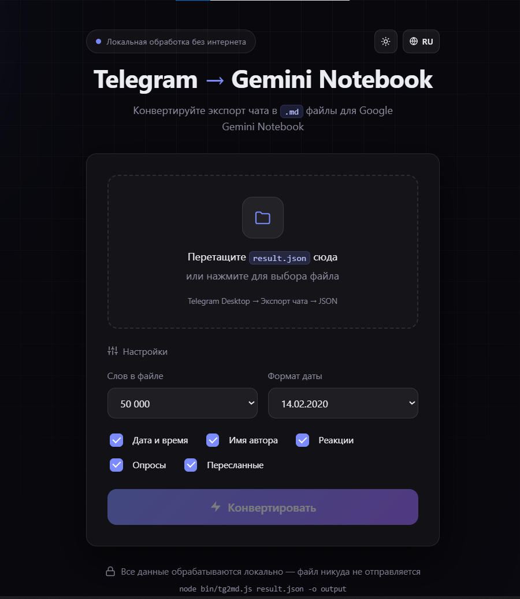
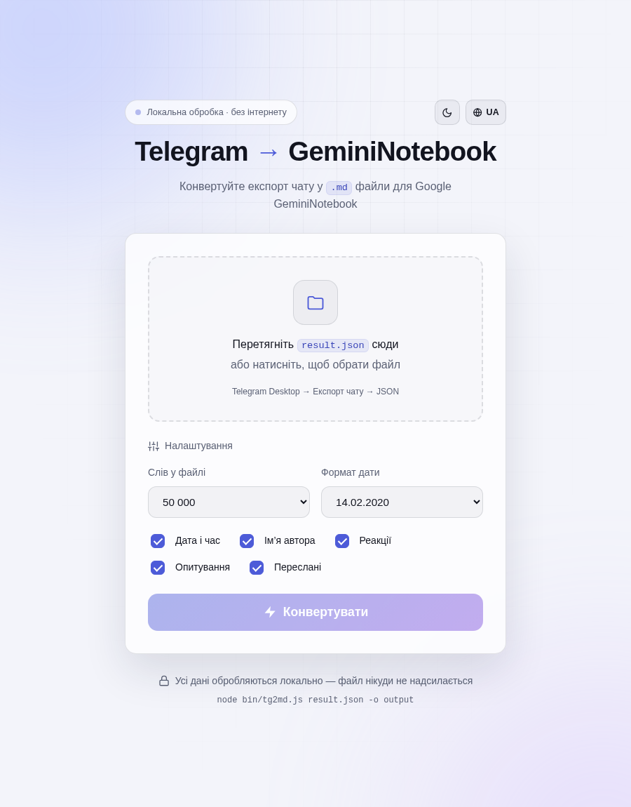
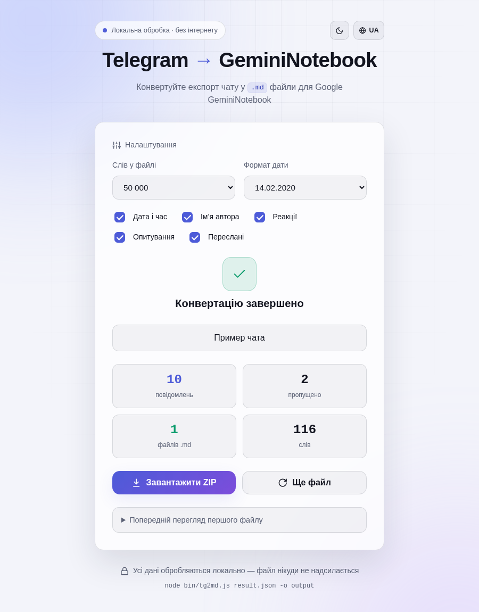

# Telegram → NotebookLM / Gemini Notebook

[Русский](README.md) · **English** · [Download a release](https://github.com/cyberclerkua-cmd/tg-notebooklm-converter/releases/latest)

An offline converter that turns **Telegram chat exports (`result.json`) into Markdown sources for Google NotebookLM / Gemini Notebook**.
It splits conversations by word count, preserves message context, and packages the results into a ZIP archive.
Use it to prepare chats, groups, and channels for search, summaries, and analysis in a notebook.

**Offline · zero runtime dependencies · browser UI and CLI · Russian / English / Ukrainian**



<details>
<summary>Light theme and conversion results</summary>





</details>

## Features

- Select or drag and drop a Telegram JSON export.
- Split conversations into parts: **50,000–500,000 words** in the UI, or a custom limit in the CLI.
- Keep message IDs and reply references such as `reply #123`.
- Include or omit timestamps, authors, reactions, polls, and forwarding metadata.
- Choose `DD.MM.YYYY` or `YYYY-MM-DD` dates.
- Download a ZIP of numbered `.md` files; save Markdown directly with the CLI.
- Preview the first document and view conversion statistics.
- Switch between three interface languages and light/dark themes.

## Quick start

### Open in a browser

1. Download the repository using **Code → Download ZIP** and extract it, or clone it with Git.
2. Open **`public/index.html`** in a modern browser.
3. Select `result.json`, adjust the options, and click **Convert**.
4. Download and extract the resulting ZIP.

Node.js is not needed for this mode. Keep the directory structure intact: the UI also loads files from `src/`.
Try [the sample export](examples/sample-result.json) to explore the app.

### Run a local server

Requires [Node.js](https://nodejs.org/) **18+**; **24 LTS** is recommended.
Run this command from the project directory:

```bash
npm start
```

Open **http://127.0.0.1:5173/**. No package installation or build step is required.
Stop the server with `Ctrl+C`.

```bash
node server.js --port 8080 --open
```

Server options: `--port` (`-p`), `--host`, and `--open`.
The default address is `127.0.0.1:5173`; `HOST` and `PORT` environment variables are also supported.

## Export a Telegram chat

1. Open **Telegram Desktop** on your computer.
2. Open the chat, group, or channel you want to export.
3. Select **⋮ → Export chat history** from that chat's menu.
4. Select a date range and **JSON / Machine-readable JSON**, then export.
5. Find **`result.json`** in the export directory.

The converter accepts **one chat per file**, with top-level `name` and `messages` fields.
Full-account exports containing multiple chats and HTML exports are not supported directly.
Media files are not required for text conversion.

## Import into NotebookLM

1. Extract the downloaded ZIP.
2. Create or open a notebook in [NotebookLM / Gemini Notebook](https://notebook.google.com/).
3. Choose **Add sources** and upload the generated **`.md` files**.
4. Ask questions about the conversation, find decisions, and generate summaries.

Markdown is a supported source type. See Google's [source import documentation](https://support.google.com/notebooklm/answer/16215270?hl=en)
for current limits. Uploading to Google is a separate step performed by the user.

## CLI

Each invocation processes one export and can be used in your own automation scripts.

```bash
# Demo: write Markdown and ZIP to ./output
node bin/tg2md.js examples/sample-result.json

# Choose an output directory and word limit
node bin/tg2md.js result.json -o ./out --words 100000

# Change date format and omit reactions
node bin/tg2md.js result.json --date YYYY-MM-DD --no-reactions

# ZIP only
node bin/tg2md.js result.json --format zip

node bin/tg2md.js --help
```

| Option | Description | Default |
| --- | --- | --- |
| `-o`, `--out <dir>` | Output directory | `./output` |
| `--words <n>` | Positive word limit for message blocks | `50000` |
| `--date <fmt>` | `DD.MM.YYYY` or `YYYY-MM-DD` | `DD.MM.YYYY` |
| `--format <fmt>` | `md`, `zip`, or `both` | `both` |
| `--no-timestamp` | Omit timestamps | Included |
| `--no-author` | Omit authors | Included |
| `--no-reactions` | Omit reactions | Included |
| `--no-polls` | Omit poll content | Included |
| `--no-forwarded` | Omit forwarding metadata | Included |
| `--quiet` | Suppress summary output | Summary enabled |
| `-h`, `--help` | Show help | — |

Quote paths containing spaces. Reusing an output directory overwrites files with the same names.
Documents are named `Chat_name_part_001.md`, `Chat_name_part_002.md`, and so on; the archive is `Chat_name.zip`.
The chat-name portion is limited to 50 characters, with spaces and reserved characters replaced by `_`.

## Local processing

In browser mode, the JSON is read and converted **inside the browser**.
The local server only serves the UI and JavaScript files; exports are not uploaded to it.
The CLI reads and writes local files. The application uses no external CDNs, analytics, or API requests.

Only the language and theme are saved in `localStorage`. Initial preferences are detected from the browser;
Russian is the fallback for languages other than English and Ukrainian.

## Behavior and limits

- Text and media captions are processed; photos, videos, documents, and voice recordings are not extracted or transcribed.
- Service entries and messages with neither text nor a poll are skipped. The message counter includes all entries in the input export.
- Telegram text formatting is flattened to plain text. Messages retain their original JSON order.
- Dates use the device's local time zone.
- Word limits include message text and metadata, but exclude document headings. A single oversized message is kept intact in its own file and can exceed the limit.
- The entire export is processed in memory; practical file sizes depend on the device and browser.
- UI language does not translate conversations. Part headings and CLI output are Russian; labels such as `reply`, `forwarded from`, and `Poll` are English.
- ZIP uses built-in Node.js `zlib` or browser `CompressionStream`, with an uncompressed ZIP fallback.

## Development and tests

Run the built-in Node.js tests without installing dependencies:

```bash
npm test
```

Tests cover conversion, splitting, settings, errors, ZIP integrity, CLI, the server, and UI asset consistency.
GitHub Actions runs them on Windows and Linux with Node.js 18, 22, and 24, plus a Chromium browser check.

The optional browser check requires **Python 3.10+**, Playwright, and Chromium:

```bash
python -m pip install -r scripts/requirements-ui.txt
python -m playwright install chromium
python scripts/ui-check.py
```

The script starts and stops its own test server, saving screenshots and test output to `.tmp-ui-check/`.
Contributor notes and browser-test settings are in [CONTRIBUTING.md](CONTRIBUTING.md) (Russian).
Repository metadata and publication instructions are in [docs/PUBLISHING.md](docs/PUBLISHING.md) (Russian).

## Project layout

- `public/` — browser UI, styles, and application logic.
- `src/core.js` — conversion logic shared by the browser and Node.js.
- `src/zip.js` — dependency-free ZIP writer.
- `src/i18n.js` — Russian, English, and Ukrainian dictionaries.
- `bin/tg2md.js` — command-line converter.
- `server.js` — local static server.
- `examples/` — demonstration export.
- `test/` and `scripts/` — automated tests and optional browser checks.

## Credits and license

Licensed under [MIT](LICENSE).
