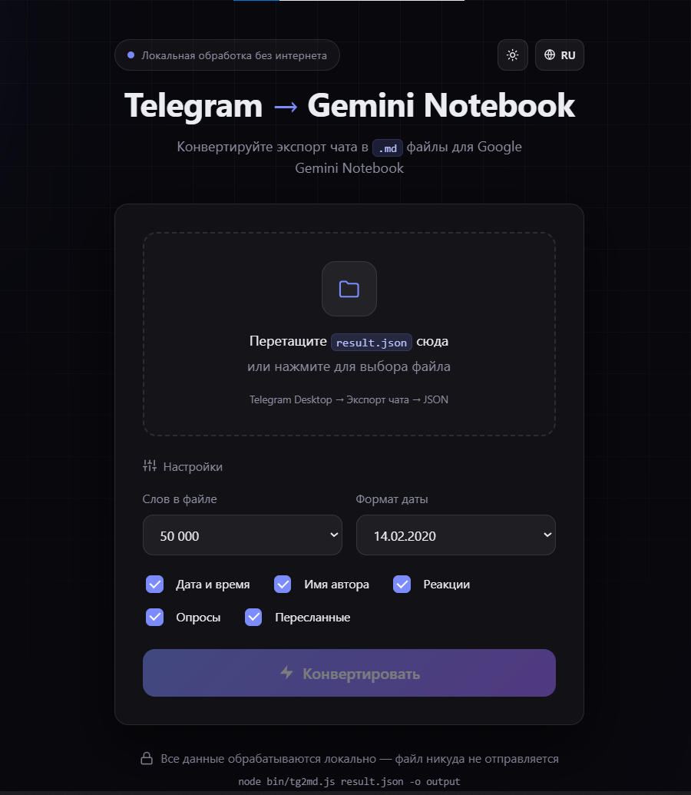
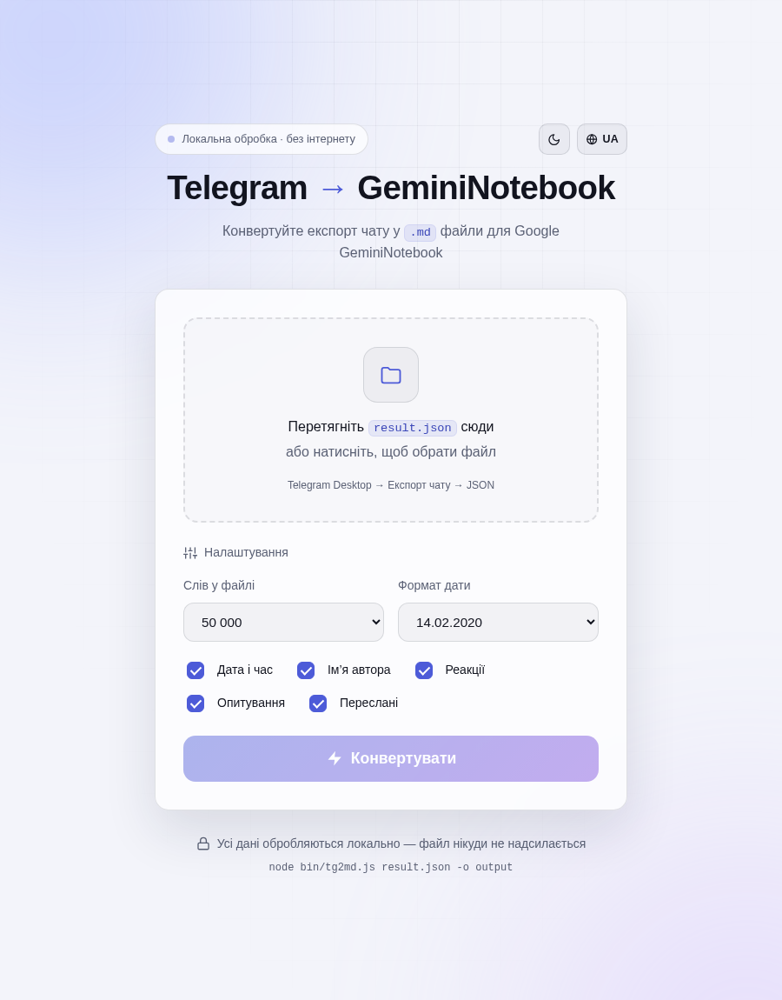
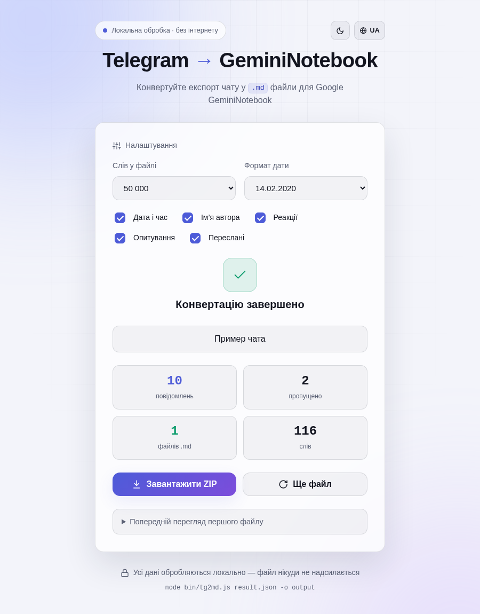

# Telegram → Gemini Notebook

**Русский** · [English](README.en.md) · [Скачать релиз](https://github.com/cyberclerkua-cmd/tg-notebooklm-converter/releases/latest)

Локальный конвертер экспорта Telegram (`result.json`) в **Markdown для Google Gemini Notebook**.
Разбивает переписку на удобные части, сохраняет контекст сообщений и собирает результат в ZIP-архив.
Подходит для подготовки истории чатов, групп и каналов к поиску, пересказу и анализу в блокноте.

**Работает офлайн · без зависимостей для запуска · браузерный интерфейс и CLI · RU / EN / UK**



<details>
<summary>Светлая тема и результат конвертации</summary>





</details>

## Возможности

- Выбор JSON-файла или загрузка перетаскиванием.
- Разбивка по количеству слов: от **50 000 до 500 000** в интерфейсе; свой лимит через CLI.
- Сохранение идентификаторов сообщений и ссылок на ответы вида `reply #123`.
- Настраиваемые дата и время, имена авторов, реакции, опросы и сведения о пересылках.
- Два формата даты: `DD.MM.YYYY` и `YYYY-MM-DD`.
- ZIP с пронумерованными `.md`-файлами; через CLI можно сохранить Markdown отдельно.
- Статистика обработки и предпросмотр первого файла.
- Русский, английский и украинский интерфейс; светлая и тёмная темы.

## Быстрый старт

### В браузере

1. Скачайте репозиторий через **Code → Download ZIP** и распакуйте его или клонируйте через Git.
2. Откройте **`public/index.html`** в современном браузере.
3. Выберите `result.json`, задайте настройки и нажмите **«Конвертировать»**.
4. Скачайте ZIP и распакуйте Markdown-файлы.

Для этого способа Node.js не требуется. Сохраняйте структуру папок: интерфейс использует модули из `src/`.
Для знакомства с приложением загрузите [демонстрационный экспорт](examples/sample-result.json).

### Через локальный сервер

Требуется [Node.js](https://nodejs.org/) **18+**, рекомендуется **24 LTS**.
В терминале, открытом в папке проекта, выполните:

```bash
npm start
```

Откройте **http://127.0.0.1:5173/**. Установка npm-пакетов и сборка не нужны.
Остановка сервера — `Ctrl+C`.

Другой порт и автоматическое открытие браузера:

```bash
node server.js --port 8080 --open
```

Сервер принимает `--port` (`-p`), `--host` и `--open`.
По умолчанию используется `127.0.0.1:5173`; адрес и порт также можно задать переменными `HOST` и `PORT`.

## Как получить экспорт Telegram

1. Откройте **Telegram Desktop** на компьютере.
2. Перейдите в нужный чат, группу или канал.
3. В меню **⋮** этого чата выберите **«Экспорт истории чата» / Export chat history**.
4. Выберите период и формат **JSON / Машиночитаемый JSON**, затем запустите экспорт.
5. Откройте папку экспорта и найдите **`result.json`**.

Конвертер принимает экспорт **одного чата** с полями `name` и `messages`.
Общий экспорт аккаунта с несколькими чатами и HTML-экспорт напрямую не поддерживаются.
Медиафайлы для конвертации текста не требуются.

## Как загрузить результат в GeminiNotebook

1. Распакуйте скачанный ZIP.
2. Откройте [Gemini Notebook](https://notebook.google.com/) и создайте или выберите блокнот.
3. Нажмите **«Добавить источники»** и загрузите полученные **`.md`-файлы**.
4. Задавайте вопросы по переписке, ищите решения и договорённости, составляйте краткие пересказы.

Google поддерживает Markdown как источник. Текущие ограничения описаны в
[справке по импорту источников](https://support.google.com/notebooklm/answer/16215270?hl=ru).
Загрузка в сервис Google выполняется отдельно, самим пользователем.

## Командная строка

Один запуск обрабатывает один экспорт. CLI удобно использовать в собственных скриптах.

```bash
# Проверка на демонстрационном файле: Markdown и ZIP появятся в ./output
node bin/tg2md.js examples/sample-result.json

# Своя папка и лимит слов
node bin/tg2md.js result.json -o ./out --words 100000

# Другой формат даты, без реакций
node bin/tg2md.js result.json --date YYYY-MM-DD --no-reactions

# Только архив
node bin/tg2md.js result.json --format zip

# Полная справка
node bin/tg2md.js --help
```

| Опция | Назначение | По умолчанию |
| --- | --- | --- |
| `-o`, `--out <dir>` | Папка результата | `./output` |
| `--words <n>` | Лимит слов в блоках сообщений, положительное число | `50000` |
| `--date <fmt>` | `DD.MM.YYYY` или `YYYY-MM-DD` | `DD.MM.YYYY` |
| `--format <fmt>` | `md`, `zip` или `both` | `both` |
| `--no-timestamp` | Убрать дату и время | Дата и время включены |
| `--no-author` | Убрать имена авторов | Имена включены |
| `--no-reactions` | Убрать реакции | Реакции включены |
| `--no-polls` | Убрать содержимое опросов | Опросы включены |
| `--no-forwarded` | Убрать сведения об источнике пересылки | Сведения включены |
| `--quiet` | Убрать итоговую статистику из консоли | Статистика включена |
| `-h`, `--help` | Показать справку | — |

Пути с пробелами заключайте в кавычки. Повторный запуск в ту же папку перезаписывает одноимённые результаты.

## Формат результата

Имена файлов: `Имя_чата_part_001.md`, `Имя_чата_part_002.md`, …
Имя архива: `Имя_чата.zip`. Часть имени, полученная из названия чата, ограничена 50 символами;
пробелы и запрещённые символы заменяются на `_`.

Пример содержимого:

```markdown
# Пример чата
Часть 1 из 1

---

**#4** **Алиса Иванова** 10.04.2023 09:05
Когда собираемся?
👍 3 • 🎉 1

**#5** **Борис Петров** 10.04.2023 09:07
Вот варианты:
**Poll:** Когда собираемся?
• Пятница — 3 votes
• Суббота — 1 votes
Total: 4 voters
```

## Как обрабатываются данные

В браузерном режиме JSON читается и конвертируется **в самом браузере**.
Локальный сервер раздаёт только интерфейс и JavaScript; экспорты на него не загружаются.
CLI читает и записывает файлы на вашем компьютере. В приложении нет внешних CDN, аналитики или запросов к API.

В `localStorage` сохраняются только язык и тема. При первом запуске они определяются по настройкам браузера;
для языков, отличных от английского и украинского, используется русский интерфейс.

## Особенности и ограничения

- Обрабатывается текст, включая подписи к медиа; изображения, видео, документы и голосовые сообщения не извлекаются и не расшифровываются.
- Служебные записи и сообщения без текста и опроса пропускаются. Счётчик «сообщений» показывает все записи исходного экспорта.
- Форматирование Telegram сводится к тексту. Порядок сообщений сохраняется таким, каким он был в JSON.
- Даты выводятся в локальной таймзоне устройства.
- Лимит слов учитывает текст и метаданные сообщений, но не заголовок документа. Очень длинное сообщение остаётся целиком в отдельном файле и может превысить лимит.
- Весь экспорт обрабатывается в памяти; доступный объём зависит от устройства и браузера.
- Смена языка относится к интерфейсу. Текст переписки не переводится; заголовки частей и CLI остаются на русском, обозначения `reply`, `forwarded from` и `Poll` — на английском.
- ZIP создаётся с помощью встроенного `zlib` в Node.js или `CompressionStream` в браузере; при недоступности сжатия используется ZIP без сжатия.

## Разработка и проверки

Основные тесты используют встроенный `node:test` и запускаются без установки зависимостей:

```bash
npm test
```

Проверяются конвертация, разбиение, настройки, ошибки, ZIP, CLI, локальный сервер и согласованность ресурсов интерфейса.
GitHub Actions запускает их на Windows и Linux с Node.js 18, 22 и 24, а также выполняет браузерную проверку в Chromium.

Браузерный тест можно запустить отдельно. Для него дополнительно нужны **Python 3.10+**, Playwright и Chromium:

```bash
python -m pip install -r scripts/requirements-ui.txt
python -m playwright install chromium
python scripts/ui-check.py
```

Скрипт сам запускает и останавливает тестовый сервер. Снимки экрана и тестовые результаты сохраняются в `.tmp-ui-check/`.
Подробности — в [CONTRIBUTING.md](CONTRIBUTING.md).

## Структура проекта

```text
tg-notebooklm-converter/
├── .github/workflows/ci.yml    проверки GitHub Actions
├── bin/tg2md.js               CLI-конвертер
├── docs/                     скриншоты и инструкция публикации
├── examples/sample-result.json  демонстрационный экспорт
├── public/                   HTML, CSS и браузерное приложение
├── scripts/                  дополнительная браузерная проверка
├── src/core.js               общее ядро для Node.js и браузера
├── src/zip.js                создание ZIP
├── src/i18n.js               словари RU / EN / UK
├── test/                     автоматические тесты
├── server.js                 локальный статический сервер
└── package.json
```

Инструкции для участников: [CONTRIBUTING.md](CONTRIBUTING.md).
Описание для поля About, темы репозитория и шаги первой публикации: [docs/PUBLISHING.md](docs/PUBLISHING.md).

## Благодарности и лицензия

Лицензия — [MIT](LICENSE).
